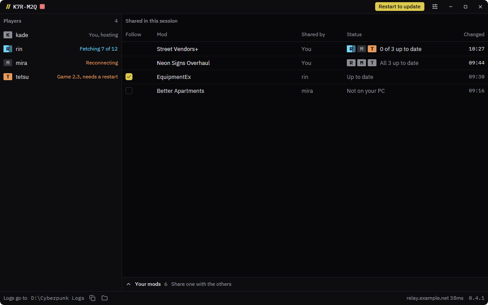
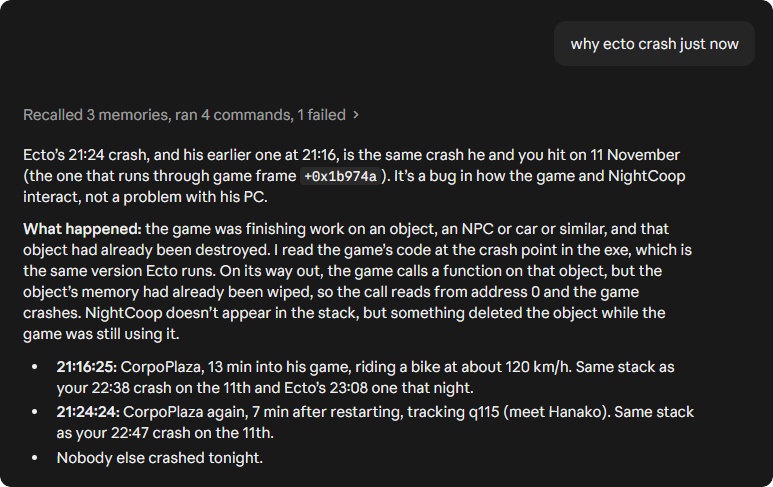
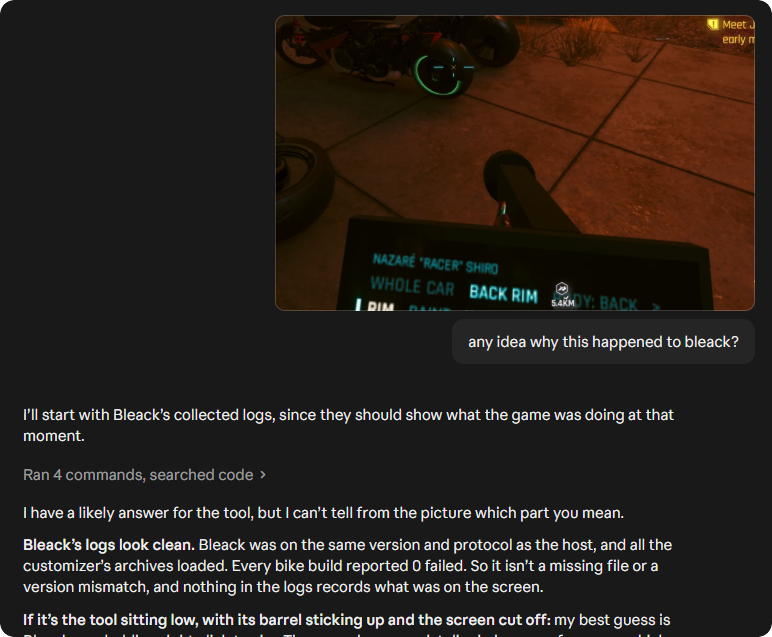

# Choom Collector

Choom Collector lets you collect everyone's logs during a NightCoop session in one place, allowing you to debug issues holistically.
It also lets anyone in the session to share mod, and for others to follow it in real time, which helps with homemade mods and testing.

When you install a new build of a mod you share, it lands in each follower's game folder within seconds.
Every log their game and mods write lands in a folder on your PC.
Point Claude at it and ask it to diagnose a crash, a mod error, or something someone saw, and it'll come up with the answer while you play.

Everyone runs the same app, on Windows or Linux, and once it's set up nobody has to touch it.



<p>
  
  
</p>

## Join a session

1. Download the app from the [latest release](https://github.com/xiprox/choom-collector/releases/latest), and open it.
2. If a box says "Windows protected your PC", choose More info, then Run anyway.
   It warns because the app isn't signed.
3. In the app's setup, on the Join tab, paste the invite your friend sent into Invite.
4. If Game says "Not found", choose Change and pick your Cyberpunk 2077 folder.
5. Choose Join.
   You'll see the session's window, with your friend and yourself under Players.
6. When your friend asks you to follow a mod, tick it under "Shared in this session", and choose Follow when the app asks.

From then on, the app joins the session by itself every time it starts.
**Leave it running while you play**, since your logs reach your friend, and their builds reach you, only while it runs.
When a new version is out, the title bar shows "Restart to update".

## Host a session

The host is the PC collecting everyone's logs.
Everyone connects through a relay the host deploys once on their own Cloudflare account, on Cloudflare's free plan, so nobody needs to open a port.

1. Deploy your relay, as [the relay's README](relay/README.md) shows.
2. Install the app, as the first two steps of [joining](#join-a-session) show.
3. In the app's setup, open the Host tab, and paste your relay's address into Relay, without `https://`.
4. Click Host.
5. Send each tester your relay and your code as one line, `<relay>/<code>`, such as `cyberpunk-coop-tools-relay.<your-subdomain>.workers.dev/K7R-M2Q`.
   Clicking the code in the title bar copies it together.

Selecting a player under Players shows their game version and system, how much of their logs has reached you, and which logs their PC is picking up.

## Share and follow mods

A mod is a top-level folder in one of the game's mod places: `bin/x64/plugins/cyber_engine_tweaks/mods`, `red4ext/plugins`, `r6/scripts`, `r6/tweaks`, `r6/input`, `archive/pc/mod`, and `mods`.
Folders with the same name in different places are treated as one mod, so a mod with the folders `r6/scripts/MyMod` and `archive/pc/mod/MyMod` is shared and followed as one.

- **Sharing:** expand "Your mods" at the bottom of the window, and tick a mod.
  It shows under "Shared in this session" for everyone.
- **Following:** tick a mod under "Shared in this session".
  When the sharer saves a file in the mod, your copy is replaced within seconds, and a file the sharer deletes is deleted from yours.
- **Updating while the game runs:** on Windows, a file the game holds is replaced once the game lets go of it, and the status says when you need to restart the game to load the new build.
- **Checking followers:** each follower gets a tile on the mod's row, which shows whether their copy is up to date, updating, or waiting for a game restart.
- **Unfollowing:** untick the mod, and the app asks whether to keep your copy or delete it.

A followed folder is a copy of the sharer's, so an edit you make in it is undone within seconds.
Files the game and its mods write while they run, such as `*.log`, `logs/`, and CET's `db.sqlite3`, are never sent and never deleted.

## Where the logs land

Each session gets a folder in your logs folder, named by its date and code, with a folder per player inside it:

```text
Choom Collector Logs/2026-11-14 K7R-M2Q/
  _status.txt          who is connected, files, data, and last data, every 5s
  _collector.log       everything that happened, every player
  <player>/
    game/...           the same layout as their game folder
    crash-reports/...
    localappdata/...
    app/...            this app's own log on their PC
    extra/...
    _peer.txt          their install ID, game version, system, sources, and connection state
    _events.log        new files, rotations, copies, files gone, and connections
    _manifest.tsv      which part of which source file each copy holds, and where it is here
    _history/<time>/   older copies a rotation, copy, or rewrite pushed out
    _long/             copies whose full path would be too long for Windows
```

Each player's PC picks up the logs in their game folder, the game's crash reports, the game's own logs and settings, and this app's log.
To pick up files a mod writes that aren't logs, such as `bin/x64/StreetVendors/*.csv`, list them under "Extra files to pick up" in Settings, and every player's PC picks them up too.
When a tester joins, they send their recent logs, and after that each new line as it's written.
Copies are plain files, readable while they're being written.

### Reading them with AI

Tell the AI once where the logs are, and ask it to remember.

```text
Logs from everyone in my Cyberpunk 2077 co-op sessions are collected with Choom Collector (https://github.com/xiprox/choom-collector) into C:\Users\<user>\Documents\Choom Collector Logs, one folder per session named by its date and code, with a folder per player inside.
When I ask you to diagnose a crash, a mod error, or something a tester saw, read these logs instead of the game's logs on this PC: start with the newest session's _status.txt and _collector.log, then the folder of the player it's about.
Save this in memory.
```

## What it isn't

- **Not a log viewer.**
  This app is designed for having AI read the logs, not the user, so it has no log browsing/viewing features.
- **Not a mod manager.**
  It doesn't install mods from Nexus, order them, or resolve conflicts; it only blindly copies the folders a player shares.
- **Not for other games.**
  It knows only Cyberpunk 2077's folders and mod places. A fork for another game is welcome.

## Known limits

- A session holds the host and up to 8 testers.
- Players can't reach each other directly, so when the host's app isn't running, no logs or mods move.
  Everyone's copies stay as they are, and a file on its way picks up where it stopped.
- A tester whose game version differs from the host's is told so, since mods built for one version may not load in another.

## Build it

`cargo build` builds the workspace, and `cargo run -p choom-collector -- --demo host` opens the window on a made-up session.
The window is drawn with gpui ([decision 002](record/decisions/002-gpui-through-gpui-kit.md)), which takes minutes to compile from clean.
On Linux, the build needs the development packages that the "Install gpui's Linux packages" step of [ci.yml](.github/workflows/ci.yml) installs.

The design, the plan, and what each part's tests found are in [the record](record/index.md), and [CLAUDE.md](CLAUDE.md) holds the rules agents work by.
Commits follow [Conventional Commits](https://www.conventionalcommits.org/), since release-please reads them to choose each version, as [releasing](record/areas/build/releasing.md) describes.

## License

MIT; see [LICENSE](LICENSE).
